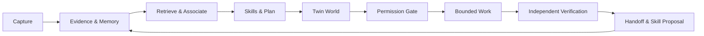

# Second Brain OS v0.2.0

**Remember what matters. Connect what seems unrelated. Turn knowledge into verifiable work.**

Second Brain OS is an **open-source, local-first cognitive workspace** for personal knowledge, persistent memory, reusable agent skills and accountable automation. Its goal is to help people capture anything, recover it with provenance, discover useful connections and delegate bounded work to agents without surrendering control over their data.

[](https://github.com/iAlirezaaa/second-brain-os/actions/workflows/ci.yml)
[](https://github.com/iAlirezaaa/second-brain-os/actions/workflows/loop.yml)
[](LICENSE)
[](VERSION)

> **Project status:** foundation plus evolving prototypes, not a finished autonomous brain. The default Python 3.9+ core uses only the standard library. Some memory, routing, actor and simulation capabilities are opt-in or under development. The CI badge shows the default branch, not a guarantee that the product is bug-free.

## What it does today

| Capability | Implemented behavior | Maturity |
| --- | --- | --- |
| Portable knowledge | Human-readable Markdown, stable numbered zones, registry records, provenance and lifecycle rules | Foundation |
| Search and recall | SQLite FTS5/keyword retrieval, imported local source records, lessons and long-term memory interfaces | Foundation |
| Agent compatibility | MCP over stdio, a central tool registry, explicit allowlists and per-tool behavior tags | Foundation |
| Task-first CLI | Private durable sessions, skills inventory, editable task list, evidence-linked completion and mandatory handoff | New, opt-in |
| Agent execution guard | Optional strict session preflight for the central toolkit and MCP; scoped writes; metadata-only event audit | New, opt-in |
| ADHD associations | Cross-domain lexical associations with original source paths, explicitly marked as hypotheses | Initial baseline |
| Twin World | In-memory task and UTF-8 file-change rehearsal, unified diffs, content hashes and protected-path refusals | Simulation only |
| Laya typed decisions | Optional local choice/score/yes-no proposals and confidence-based abstention | Adapter; model not bundled |
| Integrity and recovery | Repository health gates, CI tests and a synthetic cross-machine encrypted-backup restore test | Foundations; production recovery is separate |

**Not shipped as complete:** self-training, independent signed multi-user identity, fully isolated code-execution sandboxes, unsupervised skill promotion, real-time long-running autonomous multi-agent orchestration, production-grade cross-device sync or a proven semantic/temporal graph replacement.

## The operating loop



Every agent should look for reusable skills and create an explicit to-do list **before doing work**. Each new task stays visible. Verified outcomes become proposed improvements; promotion to trusted knowledge, canonical skills or code remains under the owner's control.

- **Master architecture:** [Product Vision](00_START_HERE/PRODUCT_VNEXT.md)
- **Accountable agents:** [Agent identities and workflows](00_START_HERE/AGENT_TEAM_VNEXT.md)
- **Engineering research:** [Open-source comparisons and adoption rules](00_START_HERE/TECH_RESEARCH_VNEXT.md)
- **Architecture and zones:** [System map](00_START_HERE/SYSTEM_MAP.md) · [Structure guide](00_START_HERE/REPO_STRUCTURE.md)
- **Engineering guardrails:** [Agent instructions](AGENTS.md) · [Security policy](SECURITY.md) · [Contributing](CONTRIBUTING.md)

## Quickstart

Prerequisites: **Python 3.9 or later** and Git. No Obsidian account, cloud model or background service is required.

On Windows (PowerShell), confirm `python --version` is 3.9 or newer before
copying the commands below. If `python` does not resolve and the optional
Python Launcher is installed, check `py -3 --version` and replace the `python`
command prefix with `py -3`. On macOS/Linux, use `python3` instead of `python`
when only that command resolves to a supported version. No specific minor
version such as 3.10 is required. Use a UTF-8 terminal for non-ASCII output.

```bash
git clone https://github.com/iAlirezaaa/second-brain-os.git
cd second-brain-os
python scripts/health.py
python -m unittest discover -s tests
```

### Your first local recall (no account or model)

From the cloned repository, run:

```bash
python scripts/kb.py ingest
python scripts/kb.py search "memory"
```

The first command builds a local index of the repository's tracked Markdown; the
second prints matching file paths and excerpts. Your index lives at `.kb/kb.sqlite`,
which is gitignored, and the commands need no network or API key. This is
**keyword-based retrieval**, not semantic memory. Symlinked Markdown files and notes reached through
symlinked directories are excluded from the index to avoid aliases crossing
knowledge boundaries. Re-run `python scripts/kb.py ingest` after updating to
remove any older aliases from your derived index. In your own installed brain,
index your notes with the same command from that brain's directory. See the
[first-session guide](skills/first-session/SKILL.md) if you are working as an agent.

To verify this path independently on **synthetic** notes (no private data), run:

```bash
python scripts/first_success.py --repeat 3
```

This bounded, offline smoke probe creates disposable Markdown, invokes the real
`kb.py ingest` and `kb.py search` commands, and prints JSON containing observed
success rate and per-trial/median latency. It exits nonzero on any failed
trial and cleans up its temporary index. **It does not measure Git clone,
installation, full first-use time, semantic recall or real-user performance.**
The current under-five-minute end-to-end onboarding goal remains unverified.
See [first-success acceptance criteria](https://github.com/iAlirezaaa/second-brain-os/issues/93).

Use the CLI to discover skills, open an accountable session and monitor it:

```bash
python scripts/brain.py --help
python scripts/brain.py skills --query "research"
python scripts/brain.py start --goal "Research an idea and retain reliable sources"
# Replace SESSION_ID with the SES-... identifier returned above:
python scripts/brain.py status SESSION_ID
python scripts/brain.py add SESSION_ID --task "Independently verify key findings"
python scripts/brain.py trace SESSION_ID
```

A successful close requires completed tasks, inspected evidence, a fresh handoff and explicit human confirmation. Ending a session creates a **draft** skill proposal, never an automatically trusted executable skill.

Start the MCP server for compatible agent hosts:

```bash
python 15_SYSTEM/scripts/mcp_server.py
```

For **strict session enforcement** on central toolkit/MCP calls, opt in with the process environment variable `SBO_REQUIRE_SESSION=1`, then provide registered actor/session metadata on calls. This is a local coordination boundary, **not** cryptographic authentication. See the [complete CLI guide](00_START_HERE/CLI_VNEXT.md) before enabling strict mode.

### Working with knowledge and private sources

```bash
python scripts/kb.py --help
python scripts/sources.py --help
python scripts/memory.py --help
```

Local source importing and searching are documented in [Source ingestion](15_SYSTEM/integrations/local-sources.md). Imported private data is kept out of Git by default. Do not upload personal records, credentials, local database files or model checkpoints to public repositories.

### Optional local Laya decision engine

The core runs without PyTorch or Laya. For a separate Python 3.10+ environment, read [Laya installation](15_SYSTEM/integrations/laya.md) and [optional dependencies](requirements-laya.txt). This adapter only **proposes** classifications; it does not run tools or authorize actions. Model weights and model-specific benchmarks are not provided.

### Simulate before applying changes

```bash
python scripts/brain.py twin-files --plan /path/to/changes.json
```

Twin World 1a creates an in-memory overlay and reports a bounded diff. **It does not run untrusted code and is not a VM/container sandbox.**

## Repository organization

| Location | Responsibility |
| --- | --- |
| `00_START_HERE/` | Product documentation, governance, onboarding |
| `01_INBOX/`–`10_ARCHIVE/` | Human-owned knowledge, projects, creative work and archive |
| `11_CONTROL/` | Agent, skill, schedule and policy registry |
| `12_RUNTIME/`, `13_LAB/` | Local-only runtime/experimental planes; intentionally not committed |
| `14_CANDIDATES/` | Reviewable proposed improvements, separate from trusted knowledge |
| `15_SYSTEM/` | Engine internals, memory schemas and integrations |
| `scripts/` | Human-invoked CLI and governance commands |
| `skills/` | Reusable SKILL.md procedures with metadata-first discovery |
| `tests/` | Offline regression and compatibility suites |
| `rules/`, `vault-template/` | Machine-checked contracts and optional notebook template |

**Placement policy:** do not move `scripts/`, `15_SYSTEM/scripts/`, `11_CONTROL/` or numbered zones merely for aesthetics. The architecture has path-based registries, permission boundaries and tests. Structural migrations require a reference audit, compatibility redirects where appropriate, reproducible tests and a rollback plan.

## Engineering and quality

The CI workflow validates Python 3.9 and 3.12 on Ubuntu and Windows, runs health gates, unit tests, the HADES fresh-clone battery and synthetic cross-host recovery checks. Superseded PR commits are cancelled to reduce queue noise. The nightly improvement loop should publish a reviewable report branch instead of attempting to push through `main` protection.

A green CI result is an important **minimum**, not a product-completeness score. Report problems through [GitHub Issues](https://github.com/iAlirezaaa/second-brain-os/issues), and keep verified fixes attached to regression tests. See [Roadmap](ROADMAP.md) and [Issue ledger](00_START_HERE/ISSUES.md).

### Reproducible repository measurements

This table is regenerated by `python scripts/doc_report.py --write`. A failed measurement or duplicate measured block must fail closed.

<!-- BEGIN measured — written by `python scripts/doc_report.py --write` -->
| measure | now |
| --- | --- |
| tests collected (`python -m unittest discover -s tests`) | 1119 |
| health gates (`python scripts/health.py`) | 17 |
| registry records (`11_CONTROL/**/*.json`) | 20 |
| skills in the pack (`skills/*/SKILL.md`) | 14 |
| agent-host doors (`python scripts/sync_hosts.py --list`) | 5 |
| active lessons (`15_SYSTEM/memory/lessons.jsonl`) | 27 |
| candidate rows on the shelf (`14_CANDIDATES/loop`) | 6 |
| kinds in the contract (`15_SYSTEM/config/system.json`) | 34 |
| relation types in the contract | 13 |
| zones a fresh clone reproduces / declared (`12_RUNTIME`, `13_LAB` are gitignored) | 12 / 16 |
| python floor | 3.9 (standard library only) |
<!-- END measured -->

## License and translations

Distributed under the [MIT License](LICENSE). See [Contributing](CONTRIBUTING.md), [Code of Conduct](CODE_OF_CONDUCT.md) and [Security](SECURITY.md).

**Persian documentation:** [Persian-language guide](00_START_HERE/README_FA.md).
